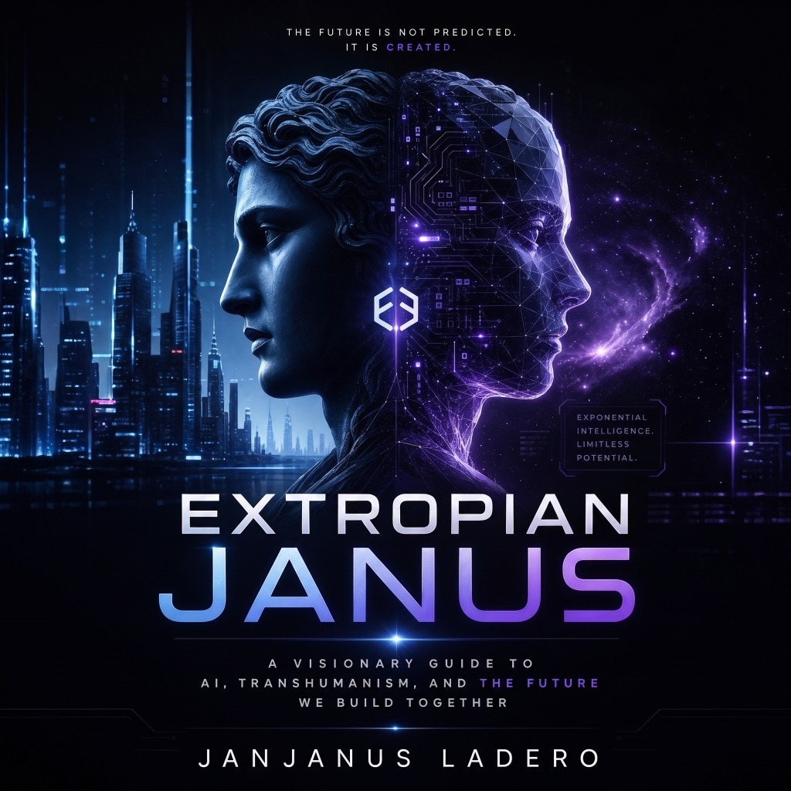

<div align="center">

  

  # EXTROPIAN JANUS
  ### ExJanAI Blockchain — Proposed Kaspa-Integrated Layer 2 Architecture

  **"THE FUTURE IS NOT PREDICTED. IT IS CREATED."**  
  *Exponential Intelligence • Limitless Potential*

  [](LICENSE)
  [](https://nodejs.org/)
  []()
  [](https://kaspa.org)

</div>

---

## 🌌 Official Identity & Mission

**ExJanAI Blockchain (Extropian Janus)** is an independently developed Layer 2 blockchain architecture engineered to integrate with the **Kaspa BlockDAG**. The project synthesizes:
1. **Deterministic L2 State Machine**: Account nonces, Sparse Merkle Tree (SMT) state roots, and replay-proof transaction execution.
2. **Kaspa L1 Settlement Adapter**: Binary commitment packing (`EXJA` magic bytes, batch roots, blue scores), DAG reorg resilience, and withdrawal queues.
3. **ZK Proof Abstraction**: Trace constraint evaluation compatible with Kaspa's **KIP-16 (`OpZkPrecompile`)** and Groth16 pairings on BN254.
4. **ChainCheck Infrastructure Diagnostics**: Protocol-aware prober for Kaspa wRPC/REST and EVM endpoints, equipped with strict SSRF and DNS rebinding protections.
5. **ExJanAI Upstream Intelligence**: Automated monitoring of Kaspa releases, KIPs (KIP-16/17/20/21/24/25), Silverscript, vProgs, and RISC Zero.
6. **Zero-Capital Posture**: Fully operable on a **~$1.00 USD capital budget** with zero paid cloud dependencies, local SQLite persistence, and free-tier infrastructure.

---

## ⚡ Quick Start (Run in 30 Seconds)

```bash
# 1. Clone repository
git clone https://github.com/exjanai/exjanai-blockchain.git
cd exjanai-blockchain

# 2. Run all 23 automated tests
npm test

# 3. Run the 10-step End-to-End Prototype Demo
npm run prototype:demo

# 4. Launch the Web Explorer Dashboard & API Server
npm start
```
Visit **`http://localhost:3000`** in your browser to experience the **Extropian Janus Cyber-Classical Web Explorer**, live BlockDAG telemetry, interactive ChainCheck diagnostics, and the intelligence monitor.

---

## 🏛️ Architecture & Verification Flow

```
                      +---------------------------------------+
                      |       ExJanAI Client Applications     |
                      |   (CLI, Test Wallet, Web Explorer)    |
                      +-------------------+-------------------+
                                          |
                                          v  [Signed secp256k1 Operations]
+---------------------------------------------------------------------------------+
|                        ExJanAI Layer 2 Node & Engine                            |
|                                                                                 |
|  +--------------------+   +-----------------------+   +----------------------+  |
|  | Mempool & Nonce    |-->| Deterministic State   |-->| Sparse Merkle Tree   |  |
|  | Replay Guard       |   | Transition Machine    |   | State Root Engine    |  |
|  +--------------------+   +-----------------------+   +----------------------+  |
|                                       |                                         |
|                                       v                                         |
|  +--------------------+   +-----------------------+   +----------------------+  |
|  | Batch Aggregator   |-->| Trace Prover Engine   |-->| L1 Settlement        |  |
|  | (Block Builder)    |   | (KIP-16 Prepared)     |   | Adapter Engine       |  |
|  +--------------------+   +-----------------------+   +----------------------+  |
+---------------------------------------------------------------------------------+
                                        |
                   [Anchored Binary Commitments & Blue Score Tracking]
                                        v
+---------------------------------------------------------------------------------+
|                               Kaspa Layer 1 (L1)                                |
|             (GHOSTDAG Consensus / Testnet-10 / Testnet-11 Toccata)              |
+---------------------------------------------------------------------------------+
```

---

## 🛠️ Developer CLI Tools

### `exjanai` CLI
```bash
# Generate secp256k1 keypair
npm run cli keygen

# Inspect node status, state root, and Kaspa blue score
npm run cli status

# Produce an L2 batch and settle on Kaspa L1
npm run cli produce-batch

# Query account balance and nonce
npm run cli account 0x...
```

### ChainCheck Diagnostics CLI
```bash
# Run SSRF-guarded diagnostic probe
npm run chaincheck

# Export standalone HTML diagnostic report
node src/cli/chaincheck-cli.ts https://api-testnet-10.kaspa.org --html
```

### Intelligence Monitor CLI
```bash
# View tracked Kaspa KIPs and upstream releases
npm run intel
```

---

## 📚 Technical Documentation

- [RESEARCH.md](docs/RESEARCH.md) — Comprehensive upstream analysis covering 12 repositories, KIP-16/17/20/21/24/25, and architectural decision.
- [ARCHITECTURE.md](docs/ARCHITECTURE.md) — Technical specification for execution, state trie, proof interface, settlement, and threat model.
- [COMPATIBILITY_MATRIX.md](docs/COMPATIBILITY_MATRIX.md) — Protocol compatibility matrix across Kaspa networks and opcodes.
- [SECURITY.md](docs/SECURITY.md) — Security threat model and test validations.
- [LOCAL_TESTNET.md](docs/LOCAL_TESTNET.md) — Complete local testnet developer setup guide.
- [COST_BREAKDOWN.md](docs/COST_BREAKDOWN.md) — $1 budget allocation and hardware compute profiles.
- [VALIDATION_PLAN.md](docs/VALIDATION_PLAN.md) — 30-day adoption and testnet validation plan.
- [LIMITATIONS.md](docs/LIMITATIONS.md) — Honest disclosure of prototype boundaries.

---

## 🔒 Security & Disclaimers

ExJanAI Blockchain is an **independent development and testnet prototype**. It is not officially affiliated with the Kaspa organization and is not a production mainnet L2. Real funds must not be moved onto the network.
